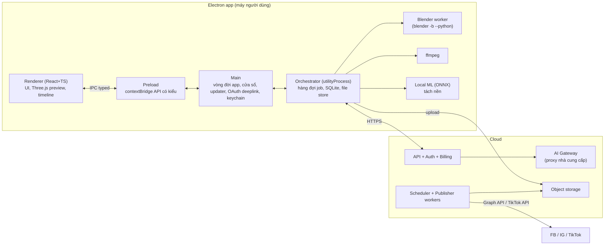
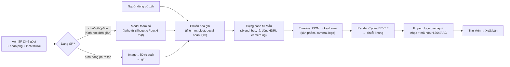
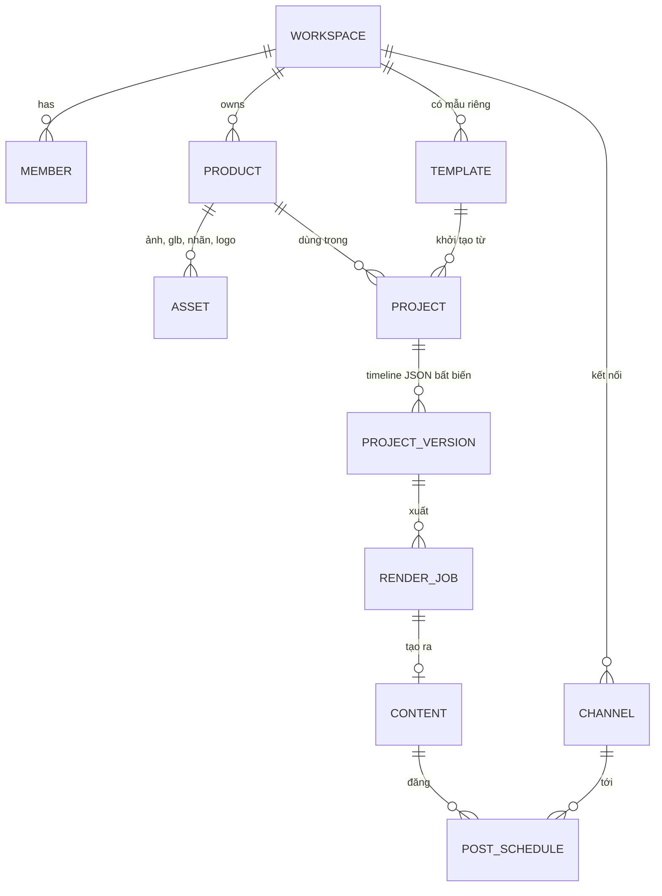

# AI Product Studio — Kế hoạch triển khai nền tảng AI + Blender (Electron)

> **Cập nhật 16/11/2026:** đã khớp 7 quyết định của user (xem mục 7.3 "Đã quyết định" và [project-context.md](project-context.md)). Thay đổi chính: Blender **4.5 LTS** tải lần đầu (+ bộ cài offline); MVP chỉ **xuất video + caption để đăng thủ công**, đăng API là V1; backend **NestJS + PostgreSQL + S3-compatible**; pilot thanh toán **chuyển khoản**; **i18n từ đầu** (vi trước); MVP có **preview nhẹ + render local**, giao diện job sẵn cho cloud render (V1). Backlog Phase 0 ở mục 9.
>
> Phạm vi: nghiên cứu/kế hoạch, không có code. Nguồn: 8 ảnh thiết kế UI (thực tế là 6 màn hình riêng biệt: ảnh 03 = 06 và 07 = 08 trùng nhau) + tra cứu tài liệu hiện hành (Blender, Meta, TikTok, electron-builder, giá API image-to-3D). Mọi con số hiệu năng/chi phí đánh dấu *(giả định)* cần đo ở PoC.

---

## 1. Sản phẩm, persona, luồng, kiểm kê

### 1.1 Tóm tắt
Ứng dụng desktop cho SMB (mỹ phẩm, F&B, quà tặng…) biến **ảnh chụp sản phẩm thường** thành **ảnh/video 3D quảng cáo** (xoay 360°, camera chuyển động, bối cảnh đẹp, logo cuối video) và **đăng thẳng lên Facebook/Instagram/TikTok** theo lịch — không cần biết 3D, không cần designer. Giá trị cốt lõi: *đúng sản phẩm, đúng nhãn, nhanh, rẻ hơn thuê studio*.

### 1.2 Persona
| Persona | Mô tả | Nhu cầu chính | Ràng buộc |
|---|---|---|---|
| **Chủ shop / marketer SMB** (James – UNICOM Workspace) | 1–10 người, 5–200 SKU, tự chạy social | Ra 5–10 nội dung/tuần, giống thương hiệu | Không rành kỹ thuật; **máy văn phòng/laptop thường, thường không có GPU rời** |
| **Nhân viên content** | Vận hành hằng ngày | Lặp lại theo mẫu, lên lịch hàng loạt | Cần workspace chung, phân quyền |
| **Agency nhỏ** (sau) | Nhiều thương hiệu | Nhiều workspace, xuất hàng loạt | Cần quota/credit rõ |

### 1.3 Luồng chính (khớp wizard 4 bước trong thiết kế)
```
Thêm sản phẩm (ảnh/.glb, nhãn, màu thương hiệu, kích thước)
  → [Studio] 1 Sản phẩm → 2 Chọn cảnh (Kho mẫu) → 3 Tùy chỉnh (Ảnh | Video 3D, Đạo diễn AI)
  → 4 Xuất (render, vào Thư viện) → Kênh & Xuất bản (caption AI, ảnh bìa, lịch) → theo dõi trạng thái
```

### 1.4 Kiểm kê màn hình & tính năng (độ ưu tiên)
Ảnh 01 Studio video · 02 Sản phẩm · 03/06 Kho mẫu · 04 Thư viện · 05 Kênh & Xuất bản · 07/08 Studio ảnh.

| Khu vực | Tính năng thấy trong thiết kế | Ưu tiên |
|---|---|---|
| **Sản phẩm** | Lưới/danh sách, lọc "Có mô hình 3D / Chỉ có ảnh", tìm kiếm, danh mục, thương hiệu, panel chi tiết (4 ảnh, `serum.glb`, `label.png`, kích thước 60×60×146 mm, màu thương hiệu) | **MVP** |
| | Thêm sản phẩm → **tạo model 3D từ ảnh** (không có màn hình thiết kế!) | **MVP** (cốt lõi) |
| | Nhập hàng loạt (CSV/SKU), phân trang lớn | v1 |
| **Studio ảnh** | Đổi bối cảnh (4 preset: Studio/Thiên nhiên/Tối giản/Cao cấp), màu nền, ánh sáng, góc máy, **đổ bóng 70%**, tỷ lệ 1:1/4:5/16:9, zoom, undo/redo, "Giữ nguyên nhãn" | **MVP** |
| | Prompt "Bạn muốn thay đổi điều gì?" + chip *Đổi bối cảnh / Thêm đạo cụ / Gợi ý ý tưởng* | MVP (đổi bối cảnh, prompt→tham số) / v1 (thêm đạo cụ, gợi ý) |
| **Studio video 3D** | Chuyển động: Xoay 360°, Quay quanh, Tiến gần, Nâng sản phẩm; thời lượng, tốc độ, easing | MVP: Xoay 360°, Quay quanh, Tiến gần · v1: Nâng sản phẩm |
| | Camera (góc máy), tỷ lệ 16:9/9:16/1:1, chất lượng 1080p/30fps, "Giữ nguyên nhãn" | **MVP** |
| | Timeline đa track (Sản phẩm/Camera/Logo) + keyframe kéo thả | MVP: xem + sửa thời lượng/easing cơ bản · v1: kéo keyframe tự do |
| | Thành phần cảnh bật/tắt (Sản phẩm, Bục, Lá, Logo), bảng màu | MVP (bật/tắt) · v1 (đổi vật liệu/màu) |
| | **Đạo diễn AI** (prompt → timeline) | **MVP-lite** (parse prompt → preset + tham số) → v1 đầy đủ |
| | Âm thanh: thêm nhạc nền | v1 (cần thư viện nhạc có bản quyền) |
| | "Xem trước 3D" realtime | MVP (Three.js xấp xỉ, **cấu hình xem trước nhẹ** cho máy yếu: giảm độ phân giải/bóng/phản chiếu, tự hạ theo benchmark) |
| **Kho mẫu** | 36 mẫu, tab Ảnh/Video/Mẫu của tôi, lọc ngành hàng/phong cách/tỷ lệ, xem trước, "Dùng mẫu này", "Lưu mẫu", yêu thích | MVP: ~15–20 mẫu cài sẵn, lọc cơ bản · v1: mẫu của tôi, tải mẫu mới từ cloud |
| **Thư viện** | Lưới/danh sách, thư mục, thẻ, yêu thích, phiên bản (V2), trạng thái "Đang xuất 68%", tải xuống, mở lại trong Studio, đổi tên, di chuyển | **MVP** (trừ thư mục/thẻ nâng cao → v1) |
| **Kênh & Xuất bản** | **Bản rút gọn "Chuẩn bị đăng thủ công"**: chọn nội dung → caption/hashtag/ảnh bìa theo kênh, preview FB/IG, "AI viết caption", sao chép caption + mở thư mục file/tải video | **MVP** (không cần OAuth/lịch) |
| | Kết nối FB/IG qua API, đăng ngay, lịch đăng, preview theo kênh đã kết nối | **V1** (Facebook + Instagram) |
| | TikTok (đang "Chưa cấp quyền đăng") | V1: gửi vào hộp nháp · V1.5: Direct Post sau audit |
| | Lịch xuất bản (menu có, **không có màn hình**), nháp, "chạy khi đóng ứng dụng" | **V1** (cần cloud worker) |
| **Cloud render (job UI)** | Màn/khối "Hàng đợi & job": trạng thái, ước thời gian, nơi chạy (Máy này / Cloud) | MVP: **UI job dùng chung, chỉ chạy local** (nút Cloud ẩn/"sắp có") · V1: bật cloud render |
| **Khác** | Workspace switcher, Tổng quan (dashboard — **chưa thiết kế**), Hướng dẫn, Đăng nhập, thanh toán, cài đặt | MVP: đăng nhập + workspace (NestJS), **i18n khung (vi mặc định)**, **thanh toán pilot = chuyển khoản, cấp gói thủ công trong trang admin** · V1: cổng thanh toán tự động · dashboard sau |
| **Sau** | Nâng sản phẩm/animation tự do, đa ngôn ngữ, cộng tác realtime, render cloud, API/CSV batch, phân tích hiệu quả bài đăng | Sau |

**MVP "dùng được" = từ ảnh sản phẩm → ảnh + video xoay 360° đúng nhãn → vào Thư viện → xuất file + caption (AI) để người dùng tự đăng.** Đăng qua API/lên lịch là **V1** (*thủ tục Meta/TikTok làm song song từ Phase 0* vì review có độ trễ — mục 5). Quy ước ở các mục sau: "v1" = "V1".

---

## 2. Kiến trúc đề xuất

### 2.1 Tổng quan


### 2.2 Electron
| Hạng mục | Quyết định |
|---|---|
| Tiến trình | **Main** mỏng (cửa sổ, menu, updater, deeplink, `safeStorage`). **Orchestrator** chạy ở `utilityProcess` (không chặn main/UI): hàng đợi job, SQLite, spawn Blender/ffmpeg, upload. **Renderer** chỉ UI. |
| UI stack | React + TypeScript + Vite (electron-vite), Tailwind + Radix/shadcn, TanStack Query + Zustand, **react-three-fiber/Three.js** (preview glb, gizmo), timeline tự dựng (canvas/DOM) |
| IPC | Kênh có kiểu (schema zod dùng chung `packages/shared`), 2 loại: *invoke* (yêu cầu/đáp) và *event stream* (tiến độ render). Renderer **không** có Node API. |
| Bảo mật | `contextIsolation:true`, `sandbox:true`, `nodeIntegration:false`; CSP chặt; kiểm tra `senderFrame` mọi handler; chặn điều hướng/`window.open`; chỉ mở link ngoài qua allowlist; protocol riêng `asset://` để đọc file thư viện (không `file://`); Electron Fuses (tắt `RunAsNode`, bật ASAR integrity); secret/token chỉ ở main/cloud, **khóa API AI không bao giờ nằm trong app** (qua AI Gateway) |
| An toàn Blender | Spawn bằng mảng đối số (không shell); chỉ chạy script nằm trong bundle (allowlist); giữ `--disable-autoexec` (mặc định); **chỉ nhận `.glb`/ảnh, không nhận `.blend` của người dùng**; giới hạn kích thước/số tam giác/texture + timeout khi nhập |
| Lưu trữ | SQLite (`better-sqlite3`, rebuild theo Electron) + thư mục file; sao lưu DB trước mỗi migration |

### 2.3 Blender headless như worker
- **Dùng CLI, không dùng `bpy` module trong Node/Electron.** Lý do: cô lập crash/GPU driver, dễ kill/timeout, không ràng buộc phiên bản Python, hợp GPL (mục 6). Lệnh: `blender -b -noaudio --factory-startup --python-exit-code 1 --python worker.py -- job.json` (`-b` không cần màn hình; `--cycles-device OPTIX|CUDA|HIP|ONEAPI|METAL|CPU[+...]` sau `--`; audio mặc định tắt ở chế độ nền).
- **Giao thức job**: `job.json` (đầu vào) → worker in **JSON-lines** ra stdout (`{"type":"progress","frame":12,"total":450}`, `"log"`, `"error"`) → exit code. Orchestrator parse, đẩy lên UI.
- **Hai chế độ**: (a) *one-shot* cho render cuối (khởi động ~vài giây, chấp nhận được); (b) *persistent* (stdin lệnh) cho "Render thử 1 khung" EEVEE ≤ vài giây — làm ở v1 nếu đo thấy cần.
- **Render ra chuỗi PNG/EXR trên đĩa** rồi ffmpeg ghép → **resume theo khung** khi crash/tắt máy, hủy/tạm dừng dễ, không mất cả video.
- **Hàng đợi** (bảng `jobs` trong SQLite): trạng thái `queued → preparing → rendering → encoding → done | failed | canceled`; ưu tiên `preview < final`; **1 job GPU tại một thời điểm**; kiểm tra dung lượng đĩa; khôi phục job dở khi mở lại app; ước lượng thời gian từ benchmark máy.

### 2.4 Pipeline xử lý

Ghi chú thiết kế quan trọng:
1. **Nhãn là decal tách riêng** (`label.png` chiếu trụ/phẳng lên model, người dùng chỉnh vị trí/độ rộng/độ cao) — không phụ thuộc chất lượng texture do AI sinh. Màn hình "Nhãn bao bì" trong chi tiết sản phẩm chính là nguồn dữ liệu này (cần thêm UI đặt nhãn — thiếu trong thiết kế).
2. **Logo cuối video overlay bằng ffmpeg** từ SVG/PNG gốc (không đi qua shading 3D) → sắc nét, không biến dạng.
3. **Ảnh (Studio ảnh) không nhất thiết qua Blender 3D**: SP "Chỉ có ảnh" dùng pipeline 2D (tách nền + bối cảnh + bóng đổ); SP "có 3D" render Blender để đổi góc máy/ánh sáng chính xác. Hai đường ra cùng một `Content`.
4. **Cảnh "lai"**: nền ảnh thật (AI sinh hoặc ảnh mẫu) làm backdrop/HDRI + **bục, đạo cụ 3D thật** + **shadow catcher** để chuyển động camera nhẹ vẫn có chiều sâu; camera di chuyển lớn → dùng cảnh 3D đầy đủ do artist dựng.

### 2.5 Cycles vs EEVEE, GPU/CPU
| | **Cycles** | **EEVEE** |
|---|---|---|
| Dùng cho | Ảnh cuối, vật liệu thủy tinh/chất lỏng (chai serum hổ phách), bóng mềm, video "Chất lượng cao" | Preview, render thử, video "Nhanh/Nháp" |
| Chất lượng | Chính xác vật lý | Đẹp nhưng thủy tinh/phản chiếu cần tinh chỉnh |
| Phần cứng | GPU: OptiX/CUDA (NVIDIA), HIP (AMD RDNA1+), oneAPI (Intel Arc), Metal (Apple Silicon); **CPU vẫn chạy được** | Cần GPU hỗ trợ OpenGL 4.3 / Vulkan 1.3; **không có đường CPU thuần** *(cần kiểm chứng trong PoC khi chạy `-b` trên Windows/macOS)* |
| Tốc độ *(giả định)* | Ảnh 2048² ~10–40 s trên GPU tầm trung; 450 khung (15 s@30fps) ~15–60 phút | ~0,3–1 s/khung → 450 khung ~3–8 phút |

Chiến lược: **ảnh → Cycles** (mẫu thủy tinh) · **video → mặc định EEVEE "Nhanh", Cycles "Chất lượng cao"** · denoise OpenImageDenoise, 64–128 samples · **benchmark lúc cài** (1 cảnh chuẩn) → phân hạng máy (A: GPU rời, B: iGPU/Apple, C: CPU yếu) → đề xuất preset, ước thời gian trước khi bấm xuất · chuỗi fallback `OPTIX → CUDA → HIP/ONEAPI/METAL → CPU` với phát hiện "thiếu driver → Blender im lặng chạy CPU" (so thời gian/khung với benchmark) · máy hạng C: **MVP** = preview nhẹ + render local với preset thấp (720p/ít samples/EEVEE nếu có GPU), cảnh báo thời gian ước tính; **V1** = **render cloud** tính credit (cùng worker script chạy trong container GPU, hạ tầng ở mục 4.3).
**Job UI thiết kế sẵn cho cloud ngay từ MVP**: mô hình `RenderJob` có trường `target` (`local`|`cloud`), `estimate`, `cost_credits`; hàng đợi/tiến độ/hủy dùng chung một giao diện; MVP chỉ bật `local`. Nhờ đó V1 chỉ thêm executor cloud, không đổi UI/dữ liệu.

### 2.6 Đóng gói Blender & dung lượng
Blender 5.0.1: Windows x64 zip ~401 MB / msi ~361 MB, macOS arm64 dmg ~319 MB (từ download.blender.org). Electron + app ~150–200 MB. Ffmpeg ~80 MB, model ONNX tách nền ~50–200 MB, asset mẫu ~200–500 MB.

| Phương án | Ưu | Nhược |
|---|---|---|
| Nhúng Blender trong installer | Offline, đơn giản | Installer ~700 MB–1 GB, mỗi bản app phải tải lại |
| **Tải "Runtime pack" lần đầu (ĐÃ CHỐT)** + bộ cài offline riêng | Installer ~200 MB; cập nhật Blender/mẫu độc lập; **tách bạch GPL**; khách không có mạng ổn định dùng gói offline | Cần mạng lần đầu (trừ gói offline); phải host S3/CDN + sha256 + chữ ký |

**Cơ chế tải (quyết định đã chốt)**: manifest ký (phiên bản Blender **4.5 LTS khóa cứng**, URL, kích thước, **sha256**) → tải có **tiến trình, tiếp tục (HTTP Range) và thử lại** (backoff, tối đa N lần, mirror dự phòng) → kiểm sha256 → giải nén vào thư mục tạm → chạy smoke test `blender -b --version` + render 1 khung → mới "kích hoạt" (di chuyển nguyên tử); lỗi → giữ bản cũ, báo rõ nguyên nhân + nút thử lại. **Bộ cài offline** = một file (zip/installer) chứa runtime pack + manifest; app có "Nhập runtime từ file…" (kiểm sha256 cùng manifest). Nâng cấp Blender chỉ sau khi chạy bộ kiểm thử render/QC trên tập máy chuẩn.

Rút gọn bản Blender: bỏ add-on/tài liệu/studiolights không dùng, tách kernel GPU theo hãng (chỉ tải cái phù hợp). **Phiên bản (đã chốt): Blender 4.5 LTS**, khóa phiên bản. Lý do: Blender 5.x cần Apple Silicon + GPU Maxwell+/GCN4+/Kaby Lake+, còn 4.5 LTS hỗ trợ Mac Intel và GPU cũ hơn (NVIDIA GeForce 400+, AMD GCN1+, Intel Broadwell+) — phù hợp máy SMB cũ. Cần theo dõi vòng đời LTS và lập kế hoạch nâng cấp (kiểm thử trước, mục 7.1).

---

## 3. Lớp AI

### 3.1 Local hay cloud
| Tác vụ | Mặc định | Lý do | Ứng viên (kiểm tra giấy phép khi chọn) |
|---|---|---|---|
| Tách nền / matting | **Local** (ONNX, CPU/DirectML/CoreML) | Rẻ, nhanh (vài giây), riêng tư | BiRefNet (MIT), U²-Net (Apache-2.0). **Tránh RMBG của BRIA** (non-commercial) — cần xác minh lại |
| Ảnh → model 3D | **Cloud** (SMB không có GPU 16 GB+) | TRELLIS cần ≥16 GB VRAM, Hunyuan3D 2.1 cần 10–29 GB; TRELLIS có submodule non-commercial; Hunyuan loại trừ EU/UK/Hàn Quốc | Tripo, Meshy, Hunyuan3D (Tencent), Rodin; local = tùy chọn "Pro" sau. So sánh giá/điều khoản (chưa đo chất lượng): [image-to-3d-comparison.md](image-to-3d-comparison.md) |
| Model tham số (chai/hộp/lon) | **Local, thuật toán** | Chính xác nhãn, 0 chi phí | Tự xây trong Blender worker/`render-core` |
| Sinh nền/bối cảnh, đạo cụ | **Cloud** (image gen/edit) | Chất lượng + không cần GPU | Flux (Kontext), Gemini image, GPT-image, SDXL qua nhà host |
| Đạo diễn AI | **Cloud LLM** (structured output) | Cần hiểu tiếng Việt tốt | Claude/GPT/Gemini |
| Viết caption/hashtag | **Cloud LLM** | Rẻ | như trên |
| Nhạc nền | Thư viện có bản quyền (không sinh AI ở MVP) | Rủi ro bản quyền | Kho nhạc license rõ ràng |

Triển khai lớp AI trong repo (Đạo diễn AI rule-based + adapter LLM, caption, tách nền local, chính sách giữ nhãn): [ai-layer.md](ai-layer.md).

**AI Gateway** (backend của ta) đứng giữa: giấu API key, đo credit, đổi nhà cung cấp không cần cập nhật app, ghi log/giới hạn, bộ lọc nội dung. Giao diện `Provider` chung cho từng loại tác vụ.

### 3.2 Đạo diễn AI: prompt → timeline JSON → lệnh Blender
Nguyên tắc: **LLM không bao giờ viết `bpy`/code.** Chỉ xuất JSON theo schema chặt; app kiểm tra (zod/JSON Schema), kẹp giá trị trong giới hạn, rồi `render-core` biên dịch sang job Blender có sẵn.
```json
{
  "version": 1, "aspect": "9:16", "duration_s": 15, "fps": 30,
  "tracks": {
    "product": [{"t":0,"t_end":15,"motion":"spin360","speed":"slow","ease":"smooth"}],
    "camera":  [{"t":0,"t_end":6,"move":"dolly_in","from":"eye_level"},
                {"t":6,"t_end":15,"move":"orbit","degrees":120}],
    "logo":    [{"t":11,"t_end":15,"anim":"fade_in","position":"center"}]
  },
  "scene": {"template_id":"nature-soft","hide":[],"palette":"brand"},
  "lock_label": true
}
```
Luồng: (1) prompt + ngữ cảnh (kích thước SP, chuyển động/đạo cụ khả dụng, tỷ lệ, bảng màu) → (2) LLM trả JSON → (3) validate + sửa lỗi tự động (1 lần retry cho LLM) → (4) cập nhật timeline UI (người dùng chỉnh tiếp được — **timeline JSON là nguồn sự thật**, UI và AI cùng ghi) → (5) biên dịch → job. Với Studio ảnh: cùng cơ chế, schema "scene params" (nền, ánh sáng, bóng, đạo cụ, góc máy). Prompt "Gợi ý ý tưởng" = LLM đề xuất 3–5 JSON preset.

### 3.3 Giữ nguyên nhãn/logo (3 lớp bảo đảm)
1. **Theo cấu trúc**: nhãn là decal độ phân giải cao từ `label.png`; logo overlay ffmpeg; ảnh 2D: *ghép* sản phẩm đã tách nền lên nền mới (AI chỉ sinh nền/ánh sáng/bóng — **không** sinh lại pixel của sản phẩm). Nếu dùng chỉnh sửa ảnh sinh tạo cả khung → mặc định tắt khi "Giữ nguyên nhãn" bật.
2. **Kiểm định tự động (QC)** sau render: so vùng nhãn với nhãn gốc (SSIM/đối sánh đặc trưng + OCR chữ nhãn) tại các khung mẫu; điểm thấp → cảnh báo, tự thử lại cấu hình an toàn hơn (giảm góc nghiêng, bật sample cao).
3. **Giới hạn chuyển động có thể làm nhãn khuất/méo**: cảnh báo khi camera/xoay làm nhãn nghiêng quá ngưỡng đọc được; model tham số ưu tiên cho bao bì trụ/hộp.

### 3.4 Chi phí & độ trễ *(ước lượng, kiểm lại trước khi chốt giá)*
| Tác vụ | Chi phí/lần | Độ trễ | Ghi chú |
|---|---|---|---|
| Image→3D textured | ~$0,20–0,55 (Tripo ~$0,30; Meshy 30 credit; Hunyuan Pro ~$0,53 gồm PBR) | ~1–3 phút | **Một lần/SP**, cache theo hash ảnh; thường cần thử lại 1–2 lần |
| Tách nền local | 0 | 2–10 s | |
| Sinh nền 1 ảnh | ~$0,02–0,10 | 5–30 s | Tạo 2–4 biến thể |
| Đạo diễn AI / caption | < $0,01–0,03 | 2–8 s | |
| Render | 0 (máy người dùng) | Mục 2.5 | Render cloud nếu có: tính credit |
| Lưu trữ + băng thông | Cent/tháng/GB | | Chỉ upload bản xuất khi đăng/sao lưu |

→ **Mô hình giá theo credit** (hao AI thay đổi) + gói thuê bao theo workspace/seat. Một SP mới ≈ $0,3–1 AI; mỗi nội dung ≈ $0,05–0,3.

---

## 4. Mô hình dữ liệu & đồng bộ


| Thực thể | Trường chính |
|---|---|
| **Product** | id, sku, tên, danh mục, thương hiệu, kích thước mm (W×D×H), `brand_colors[]`, `model_status` (none/generating/ready), ảnh bìa |
| **Asset** | id, product_id, loại (`photo`/`glb`/`label`/`logo`/`music`/`prop`), đường dẫn local, `sha256`, cloud_key, kích thước, meta (UV/nhãn: vị trí, độ rộng/cao, kiểu chiếu) |
| **Template** | id, loại (ảnh/video), ngành hàng, tỷ lệ hỗ trợ, `.blend`/preset id, thành phần (collections: bục, lá…), tham số tùy chỉnh được, license/nguồn, phiên bản, `owner` (hệ thống/workspace) |
| **Project** | id, product_id, template_id, loại, tên, `current_version` |
| **ProjectVersion** | id, project_id, số phiên bản, `timeline_json`, `scene_params`, tạo bởi (user/AI), thumbnail |
| **RenderJob** | id, version_id, trạng thái, engine, thiết bị, độ phân giải/fps, tiến độ, log, thời gian |
| **Content** | id, product_id, version_id, loại, đường dẫn, định dạng/kích thước/thời lượng, thư mục, thẻ, yêu thích, `status` (đang xuất/hoàn tất/lỗi), V1/V2… |
| **Channel** | id, workspace_id, nền tảng, tên (Fanpage/Business), trạng thái kết nối, scope, **token chỉ ở server** |
| **PostSchedule** | id, content_id, channel_id, caption, hashtags, cover, `run_at` (UTC + tz hiển thị), trạng thái (`draft/uploading/scheduled/publishing/published/failed`), `external_id`, lỗi, idempotency_key |

### 4.1 Lưu local + đồng bộ cloud
- **Local-first**: SQLite + thư mục `workspace/<id>/{assets,renders,cache}` (nội dung tự đánh địa chỉ theo sha256). Làm việc offline được (trừ AI/đăng).
- **Cloud (nguồn sự thật cho)**: tài khoản, workspace, thành viên, thanh toán/credit, kênh+token, **lịch đăng**, mẫu hệ thống. **Đồng bộ metadata** Product/Project/Content theo `updated_at + device_id` (last-write-wins theo bản ghi; `ProjectVersion` bất biến nên không xung đột). **Blob (ảnh gốc, glb, bản xuất)** upload lười (khi cần đăng/ sao lưu/ dùng máy khác) bằng multipart có resume.
- Quyền riêng tư: mặc định ảnh/glb chỉ rời máy khi gọi AI cloud hoặc đăng — thể hiện rõ trong UI + điều khoản.

### 4.2 "Lịch đăng chạy khi bạn đóng ứng dụng" — cần backend (**V1**; MVP chỉ chuẩn bị đăng thủ công)
| Phương án | Đánh giá |
|---|---|
| **A. Scheduler + publisher trên cloud (khuyến nghị)** | Chạy khi máy tắt/ngủ; token giữ ở server; đúng yêu cầu thiết kế; Instagram **không có tham số lên lịch** và TikTok API không lên lịch → buộc phải tự lập lịch; Facebook Reels có `scheduled_publish_time` (10 phút–29 ngày) nhưng nên dùng chung 1 cơ chế |
| B. Agent nền trên máy (Task Scheduler/launchd) | Sai với laptop tắt/ngủ, khó vận hành, token nằm trên máy → **không dùng** |
| C. Giữ app chạy ở khay hệ thống | Mâu thuẫn với câu trong UI |

Hệ quả cần thiết kế: (1) khi bấm *Lên lịch* app phải **upload video lên cloud trước** — UI cần trạng thái "Đang tải lên (giữ ứng dụng mở đến khi xong)" rồi mới "Đã lên lịch" (thiết kế hiện chưa có); (2) IG yêu cầu `video_url` công khai → dùng signed URL ngắn hạn từ storage; (3) container IG hết hạn sau 24 h → tạo container **sát giờ đăng**; (4) worker idempotent + retry/backoff, ghi `external_id`, thông báo lỗi qua email/push/in-app; (5) hủy/sửa lịch từ app (và web đơn giản); (6) tự áp giới hạn tần suất.
### 4.3 Backend (đã quyết định)
| Lớp | Quyết định |
|---|---|
| API | **NestJS** (TypeScript, dùng chung schema zod/DTO với `packages/shared`): auth, workspace/thành viên, gói & credit, đồng bộ metadata, AI Gateway, manifest runtime/mẫu |
| CSDL | **PostgreSQL** (migration có kiểm soát; mọi bảng có `workspace_id`) |
| File | **S3-compatible storage** (S3/R2/MinIO): runtime pack, mẫu, blob người dùng (multipart + signed URL) |
| Hàng đợi | **MVP: chưa cần Redis.** Job AI gọi qua API đồng bộ/poll; tác vụ nền nhẹ dùng bảng job trong Postgres. **Thêm Redis + BullMQ khi triển khai worker cloud (V1)**: publisher/scheduler (`run_at`, retry, idempotency), cloud render, xử lý upload |
| Worker cloud (V1) | Service riêng (`apps/cloud/publisher`, `apps/cloud/render-worker`), container GPU cho render dùng lại `blender-worker/` |
| Thanh toán | **Pilot: chuyển khoản.** Khách chuyển khoản theo hóa đơn → admin xác nhận và cấp gói/credit thủ công (trang admin tối giản + sổ cái `credit_ledger` có audit log). **Chưa tích hợp cổng thanh toán**; thiết kế bảng `plan`, `subscription`, `credit_ledger`, `invoice` đủ để gắn PayOS/VNPay/MoR sau mà không đổi mô hình |
| Giấy phép/credit | Server cấp token giấy phép theo workspace, app giữ `grace` offline 7–14 ngày |

---

## 5. Tích hợp xuất bản

| | Facebook (Page) | Instagram (Business/Creator) | TikTok |
|---|---|---|---|
| Đăng nhập | OAuth qua trình duyệt hệ thống, redirect về HTTPS của ta → deeplink `app://` (không nhúng webview) | Cùng Meta app; IG phải là tài khoản chuyên nghiệp **liên kết với Page** (hoặc luồng "Instagram API with Instagram Login" — *cần xác minh còn phù hợp*) | OAuth2 (Login Kit) |
| Quyền | `pages_show_list`, `pages_manage_posts`, `pages_read_engagement`, `publish_video` | + `instagram_basic`, `instagram_content_publish` | `video.publish` (Direct Post) hoặc `video.upload` (đẩy vào hộp thư nháp) |
| Đăng video | Reels: `POST /{page-id}/video_reels` (start → upload → finish), hỗ trợ `video_state=SCHEDULED`; cờ `is_ai_generated` | Reels: tạo container `media_type=REELS` + `video_url` công khai → `media_publish`; **không có lên lịch** | `POST /v2/post/publish/video/init/`; hỗ trợ `is_aigc` |
| Giới hạn | Theo ứng dụng/Page | ~**100 bài API/24 h** (tài liệu Meta ghi lệch 50/100 → luôn gọi `content_publishing_limit`); 400 container/24 h; Reels 3 s–15 phút, MP4/MOV H.264/HEVC, AAC, 23–60 fps; caption ≤ 2.200 ký tự | ~15 bài/ngày/creator; trần số creator hoạt động 24 h |
| Duyệt | **App Review + Business Verification** để có Advanced Access cho người dùng ngoài team | như FB (cùng app) | **Chưa audit: chỉ đăng `SELF_ONLY` (riêng tư) và tối đa 5 user/24 h** → phải qua audit (quay video demo UX, tuân thủ giao diện: hiển thị creator info, toggle quảng cáo/thương hiệu, xem trước + đồng ý) |

Khuyến nghị:
- **MVP (đã chốt): không gọi API đăng.** Xuất video + ảnh bìa + caption/hashtag (AI) → người dùng đăng thủ công. **Làm thủ tục API song song** để sẵn sàng cho V1: đăng ký Meta app, Business Verification, chính sách riêng tư/điều khoản trên HTTPS, quay screencast từng quyền, nộp App Review khi có bản chạy thử ở staging; đăng ký TikTok developer app.
- V1: **Facebook + Instagram Reels/ảnh** (App Review/Business Verification có thể mất nhiều tuần, không nằm trong tầm kiểm soát — vì vậy làm sớm).
- TikTok: V1 dùng luồng **"Gửi vào hộp thư nháp" (`video.upload`)** — người dùng hoàn tất trong TikTok, không cần audit; Direct Post sau khi audit đạt. UI cần ghi rõ để khỏi hứa quá.
- Gắn cờ nội dung AI khi nền tảng có tham số; xử lý token hết hạn (user token dài hạn ~60 ngày, cần làm mới/đăng nhập lại) và Page bị gỡ quyền → trạng thái "Cần kết nối lại" (màn *Quản lý kết nối*).
- Kiểm tra trước khi đăng: tỷ lệ/độ dài/codec theo kênh (thiết kế có dòng "Video phù hợp với kênh đã chọn"); bản 16:9 không phù hợp Reels/TikTok → **render đa tỷ lệ từ một dự án** (framing khác nhau, không crop mù).

---

## 6. Đóng gói, phân phối, giấy phép

| Hạng mục | Quyết định |
|---|---|
| Installer | `electron-builder`: **Windows NSIS** (hỗ trợ auto-update), **macOS DMG + zip** (arm64 + **Intel**, vì Blender 4.5 LTS còn hỗ trợ Mac Intel). Linux không ưu tiên. **Bộ cài offline riêng** (installer app + runtime pack Blender 4.5 LTS, kèm sha256) cho khách mạng yếu. |
| Ký số | macOS: Developer ID Application + hardened runtime + **notarization** (bắt buộc cho auto-update). Windows: **Azure Trusted Signing hoặc OV** (EV không còn "tin cậy tức thì" từ 2024; SmartScreen vẫn cần thời gian tạo uy tín). Đặt `publisherName` để `electron-updater` kiểm chữ ký bản cập nhật. |
| Auto-update | `electron-updater` (feed trên S3/R2/CDN), staged rollout, kênh stable/beta; **runtime pack (Blender, ffmpeg, mẫu, model ONNX) cập nhật tách riêng**, có phiên bản + sha256 + ký; tải có tiến trình/tiếp tục/thử lại (mục 2.6); rollback được. **Blender khóa 4.5 LTS**, chỉ nâng sau kiểm thử. |
| **Giấy phép Blender (GPL-3.0)** | Blender chạy như **tiến trình riêng, nguyên bản**; phân phối kèm văn bản GPL + chỉ dẫn lấy mã nguồn. Script Python chạy *bên trong* Blender dùng `bpy` bị coi là phụ thuộc API → **phát hành `blender-worker/` dưới GPL-3.0 (repo riêng, công khai mã nguồn)**; phần còn lại của app (UI, orchestrator, AI, backend) giữ đóng, giao tiếp chỉ qua `job.json`/stdout (đúng điều kiện FAQ Blender: chạy ngoài Blender, không dùng API Blender, tạo dữ liệu rồi gọi Blender xử lý — *ở đây vẫn cần worker GPL vì cần bpy; **user đã chấp nhận công khai worker nếu giấy phép yêu cầu**; vẫn **rà soát giấy phép (luật sư) trước phát hành**, đặc biệt với bộ cài offline có đóng gói Blender; worker tách khỏi app, đặt ở repo/thư mục riêng*). Output (ảnh/video) của người dùng thuộc người dùng. |
| Thương hiệu Blender | **Không dùng tên/logo Blender trong tên sản phẩm**; chỉ nêu trung thực "Dựng hình bằng Blender" trong màn About/Licenses, logo chỉ dạng ghi công thứ cấp. |
| Thành phần khác | ffmpeg: chọn bản **LGPL** (hoặc GPL kèm tuân thủ) — chú ý bằng sáng chế/phí H.264 (dùng encoder phần cứng hệ điều hành hoặc libx264 GPL: chốt khi PoC); model AI: kiểm tra từng giấy phép (xem 3.1); liệt kê toàn bộ ở màn "Giấy phép bên thứ ba". |
| Tài sản mẫu | Chỉ dùng: tự dựng bởi artist (hợp đồng chuyển nhượng), **CC0** (Poly Haven, ambientCG), hoặc giấy phép cho phép *nhúng trong phần mềm + phân phối lại*; **tránh** CC-BY-NC, hay "Standard license" của marketplace cấm phân phối file gốc. Nhạc: thư viện có hợp đồng cho quảng cáo mạng xã hội. Lưu `license` + nguồn trong bảng Template. |
| Tài khoản/workspace | Đăng nhập email + Google qua trình duyệt hệ thống; workspace nhiều thành viên (vai trò Chủ/Quản trị/Biên tập/Xem); phiên giữ bằng token trong `safeStorage`. |
| Thanh toán/giấy phép | **Pilot: chuyển khoản**, admin xác nhận và cấp gói/credit thủ công (mục 4.3); chưa tích hợp cổng. Mô hình credit + thuê bao giữ nguyên; xác thực giấy phép/credit bằng server, **chế độ offline ngắn hạn** (7–14 ngày grace). Sau pilot: cân nhắc PayOS/VNPay/MoMo (nội địa) và Paddle/Lemon Squeezy (MoR, khách quốc tế; Stripe không có thực thể VN) + hóa đơn VAT (cần xác minh). |
| i18n | **Cấu trúc đa ngôn ngữ từ đầu**: mọi chuỗi UI qua khóa (i18next/ICU), file `locales/vi.json` mặc định + `en.json` khung; định dạng ngày/giờ/số/tiền theo locale (GMT+7 mặc định, lưu UTC); không hard-code chuỗi trong component (lint rule); prompt/caption AI nhận tham số ngôn ngữ; thông báo lỗi từ backend trả mã lỗi + client dịch. |

---

## 7. Rủi ro & điểm cần quyết định

### 7.1 Rủi ro chính
| Rủi ro | Mức | Giảm thiểu |
|---|---|---|
| **Chất lượng 3D từ ảnh** (méo, texture mờ, thủy tinh/kim loại sai) | Cao | Ưu tiên **model tham số cho bao bì hình học đơn giản**; image→3D nhiều góc (4 ảnh) + bước QC + sửa tay tối thiểu; **vật liệu thủy tinh/nhựa gán từ thư viện** thay vì tin texture AI; cho phép tải `.glb` riêng; kỳ vọng rõ cho SP phức tạp ("chỉ ảnh" vẫn dùng Studio ảnh 2D) |
| **Render chậm trên máy yếu** | Cao | Benchmark + ước giờ trước khi xuất; preset Nháp/Nhanh/Cao; EEVEE mặc định cho video; **preview nhẹ** (MVP); render theo khung có resume; chạy nền + thông báo; hạ độ dài/độ phân giải; **render cloud tính credit ở V1** (job UI đã sẵn từ MVP) |
| **Nhãn/logo biến dạng** | Cao | Mục 3.3 (decal + overlay + QC + cảnh báo góc đọc được) |
| **Phụ thuộc API social** (đổi chính sách, review chậm, TikTok chỉ riêng tư khi chưa audit) | TB (đã giảm: MVP không phụ thuộc) | MVP đăng thủ công nên không bị chặn; làm thủ tục review song song; lớp `Publisher` trừu tượng; dự phòng hộp nháp TikTok |
| **GPL/giấy phép** | TB | Mục 6: tách tiến trình, worker GPL, tham vấn luật sư sớm |
| **GPU driver khác nhau → Blender lỗi/âm thầm chạy CPU** | TB | Phát hiện bằng benchmark, log chẩn đoán, nút "gửi báo cáo", fallback CPU |
| **Dung lượng & thời gian cài** | TB | Runtime pack tải lần đầu, cài theo hãng GPU |
| **Tải runtime lỗi/chậm/hỏng** (mạng yếu, file lỗi) | TB | Checksum + tiếp tục tải + thử lại + mirror; smoke test trước khi kích hoạt; **bộ cài offline**; giữ bản cũ khi lỗi |
| **Blender 4.5 LTS hết vòng đời hỗ trợ** | Thấp–TB | Theo dõi lịch LTS; bộ kiểm thử render/QC tự động để nâng cấp có kiểm soát; `blender-worker` trừu tượng hóa API theo phiên bản |
| **Tự cấp gói thủ công (chuyển khoản) không mở rộng được** | Thấp (pilot) | Giới hạn số khách pilot; sổ cái credit + audit; gắn cổng thanh toán ở V1 |
| **Chi phí AI vượt dự kiến** | TB | Gateway đo credit, cache theo hash, hạn mức workspace, kiểm tra trước khi sinh |
| **Bản quyền nội dung/nhạc/AI** | TB | Kho nhạc có hợp đồng; điều khoản người dùng sở hữu quyền SP/logo; gắn cờ AI khi đăng |

### 7.2 Điểm mơ hồ/thiếu trong thiết kế (cần chốt)
1. **Bước "Xuất bản" (bước 4 wizard) vs nút "Xuất video/Xuất nội dung"**: xuất file (render) hay đăng social? Đề xuất: bước 4 = render → vào Thư viện → nút "Đăng" sang Kênh & Xuất bản.
2. **Thêm sản phẩm / tạo model 3D**: chưa có màn hình (tải ảnh, chọn góc, chờ AI, duyệt/sửa model, đặt nhãn). Đây là điểm sống còn.
3. **Tỷ lệ**: Studio video chọn 16:9 nhưng màn đăng hiển thị 1080×1920 (9:16) → xuất đa tỷ lệ? Một dự án = nhiều bản xuất?
4. **Xoay 360° vs Quay quanh vs Tiến gần vs Nâng**: định nghĩa chính xác (sản phẩm xoay hay camera quay) và có kết hợp được không (timeline cho thấy có).
5. **Preview vs kết quả cuối**: "Xem trước 3D" (Three.js) khác Blender → cần "Render thử 1 khung" và cách nói rõ "xem trước gần đúng".
6. **Timeline**: mức tự do thực sự (kéo keyframe? thêm track?) — ảnh hưởng lớn tới công sức; đề xuất MVP chỉ chỉnh thời lượng/easing.
7. **Hardware & máy yếu**: yêu cầu cấu hình tối thiểu (còn mở: cần số liệu từ PoC); đã chốt hướng: MVP preview nhẹ + render local, cloud render V1.
8. **Credit/giá, hạn mức** không hiện trong UI; thiếu trạng thái lỗi/hàng đợi render (chỉ có "Đang xuất 68%"), thông báo, hủy/tạm dừng.
9. **Màn hình thiếu**: Tổng quan, Lịch xuất bản, Hướng dẫn/onboarding, Quản lý kết nối, Mẫu của tôi, cài đặt/thanh toán/thành viên, đăng nhập.
10. **Nhạc nền**: nguồn nhạc, bản quyền, kho nhạc.
11. **Đăng ảnh** (carousel, ảnh đơn) — thiết kế chỉ cho video; **thư mục/thẻ/phiên bản V1/V2** nghĩa là gì (mỗi lần render hay mỗi lần sửa)?
12. **Đơn vị cho "Đạo diễn AI"**: ngôn ngữ prompt (VI/EN), phạm vi (có sinh đạo cụ mới hay chỉ chọn từ thư viện).
13. **Mô hình kinh doanh**: giá/gói cụ thể và mức credit (pilot chuyển khoản, chưa có bảng giá); offline đến mức nào (mặc định grace 7–14 ngày).

### 7.3 Đã quyết định (16/11/2026)
| # | Hạng mục | Quyết định | Hệ quả trong tài liệu |
|---|---|---|---|
| D1 | Phiên bản Blender | **4.5 LTS**, khóa phiên bản, kiểm thử trước khi nâng cấp | Hỗ trợ Mac Intel/GPU cũ; mục 2.6, 6, 7.1 |
| D2 | Phân phối Blender | **Tải lần dùng đầu**, có checksum, tiến trình, thử lại; **bộ cài offline riêng** | Mục 2.6 (cơ chế tải), 6; Backlog P0-07 |
| D3 | Xuất bản mạng xã hội | **V1.** MVP xuất video + caption để đăng thủ công; làm thủ tục API song song | Mục 1.4, 5, 8 |
| D4 | Máy yếu | MVP: **preview nhẹ + render local**; **cloud render ở V1**, thiết kế sẵn giao diện job | Mục 1.4, 2.5, 8 |
| D5 | Backend & thanh toán | **NestJS + PostgreSQL + S3-compatible**; **Redis/BullMQ khi có worker cloud**; pilot **chuyển khoản**, chưa tích hợp cổng | Mục 4.3, 6 |
| D6 | Worker GPL | Chấp nhận công khai worker nếu giấy phép yêu cầu; tách khỏi app, rà soát giấy phép trước phát hành | Mục 6 |
| D7 | Thị trường | **Việt Nam trước**, UI tiếng Việt, **i18n từ đầu** | Mục 6 (i18n), Backlog P0-02 |

Còn mở (không thuộc 7 quyết định): nhà cung cấp image→3D cụ thể (đề xuất so sánh ở P0-09, chọn 1–2 qua AI Gateway), kho nhạc, bảng giá/credit, các điểm thiết kế ở 7.2.

---

## 8. Lộ trình, việc đầu tiên, cấu trúc repo (đã cập nhật theo quyết định)

Công sức tương đối: **S** (1–2 người, hẹp) · **M** · **L** · **XL** (cả team, nhiều mảng). Không quy ra lịch; mỗi giai đoạn có **cổng nghiệm thu**.

| Phase | Mục tiêu | Nội dung | Công sức | Cổng |
|---|---|---|---|---|
| **0. PoC render** | Chứng minh Electron ↔ **Blender 4.5 LTS headless** end-to-end (backlog chi tiết ở mục 9) | Electron khung + orchestrator + tải/kiểm runtime Blender 4.5 + spawn `-b` + cảnh mẫu + glb + turntable → PNG → ffmpeg mp4; progress qua IPC; benchmark trên 5–8 máy thực (Win Intel iGPU, NVIDIA, AMD, Mac M-series + Mac Intel); decal nhãn + QC; i18n khung; song song: hồ sơ Meta/TikTok | **M** | Video 15 s đúng nhãn trên máy hạng A/B với thời gian đo được; số liệu cho preset máy yếu; checklist ở mục 9 đạt |
| **1. MVP** | Ảnh + video đúng nhãn, **xuất file + caption để đăng thủ công** | Shell UI (Sản phẩm, Studio ảnh, Studio video, Kho mẫu, Thư viện, **Chuẩn bị đăng thủ công**); SQLite; hàng đợi bền vững + **job UI dùng chung (target local, sẵn cho cloud)**; **preview nhẹ**; model tham số + image→3D cloud (AI Gateway); tách nền local; 15–20 mẫu; 3 chuyển động; Đạo diễn AI-lite; AI caption; **NestJS + PostgreSQL + S3**: đăng nhập/workspace, đồng bộ metadata, manifest runtime; **tải runtime (checksum/retry) + bộ cài offline**; **i18n (vi)**; **gói/credit cấp thủ công sau chuyển khoản (admin)**; installer + ký số + auto-update; telemetry/crash report | **XL** | Beta kín với 5–10 SMB (pilot chuyển khoản), tỷ lệ render thành công ≥ ngưỡng, nhãn QC đạt |
| **2. V1** | Đăng API + cloud + thương mại hóa | **Redis + BullMQ**; cloud worker: scheduler/publisher + **render cloud** (bật target `cloud` trong job UI); FB/IG Reels/ảnh; TikTok nháp; credit/cổng thanh toán tự động; nhạc nền; timeline kéo keyframe; mẫu của tôi, thư mục/thẻ; batch | **XL** | Qua App Review Meta; thanh toán tự động; SLA lịch đăng; render cloud ổn định |
| **3. Sau** | Mở rộng | TikTok Direct Post (sau audit), nâng sản phẩm/animation tự do, local AI (Pro), đa ngôn ngữ, phân tích hiệu quả, API/CSV, cộng tác | L–XL | — |

### 8.1 Việc đầu tiên có thể giao ngay (Phase 0) — bản tóm tắt; **backlog đầy đủ có tiêu chí hoàn thành ở mục 9**
1. **Spike Blender CLI**: `blender -b` + script dựng cảnh từ `job.json` (nhập glb, ánh sáng, bục, camera rig), turntable, xuất khung PNG, in tiến độ JSON-lines.
2. **Bộ benchmark** chạy trên máy thật: thời gian/khung Cycles vs EEVEE theo GPU/CPU, phát hiện fallback CPU im lặng, bảng kết quả.
3. **Electron skeleton** (electron-vite, preload typed IPC, utilityProcess orchestrator, bảng `jobs` SQLite) hiển thị tiến độ render thật.
4. **Decal nhãn + QC**: chiếu `label.png` lên chai trụ/hộp; hàm so khớp nhãn (SSIM + OCR); chạy trên 10 sản phẩm thực.
5. **Model tham số**: từ silhouette/ảnh 2–4 góc → lathe glb có nhãn (chai/lọ/lon) và box 6 mặt.
6. **So sánh image→3D** (Tripo/Meshy/Hunyuan/Rodin) trên 10 SP thật: chất lượng, thời gian, giá; chọn 1–2.
7. **Ffmpeg pipeline**: ghép khung, overlay logo SVG, nhạc, H.264/AAC chuẩn IG/TikTok; chọn bản ffmpeg + giấy phép.
8. **Pháp lý/vận hành song song**: đăng ký Meta app + Business Verification + chính sách riêng tư, TikTok developer app; tài khoản ký số Apple/Microsoft; tham vấn luật sư về GPL/Blender.
9. **Thiết kế bổ sung** cho designer: Thêm sản phẩm/tạo 3D/đặt nhãn, hàng đợi render, Lịch xuất bản, Tổng quan, trạng thái lỗi (mục 7.2).
10. **Làm mẫu #1–#3** bởi artist: `.blend` mẫu với collections (bục, lá, đèn), quy ước tên/thông số tùy chỉnh để UI đọc được.

### 8.2 Cấu trúc repo đề xuất (monorepo pnpm + Turborepo)
```
ai-product-studio/
├─ apps/
│  ├─ desktop/
│  │  ├─ src/main/            # vòng đời app, updater, deeplink, safeStorage
│  │  ├─ src/preload/         # contextBridge, IPC typed
│  │  ├─ src/renderer/        # React UI, three.js, timeline
│  │  └─ src/orchestrator/    # utilityProcess: queue, SQLite, spawn Blender/ffmpeg, upload
│  └─ cloud/
│     ├─ api/                 # NestJS + PostgreSQL: auth, workspace, credit/chuyển khoản (admin), sync, manifest runtime
│     ├─ ai-gateway/          # proxy nhà cung cấp, credit, cache (module của api ở MVP)
│     ├─ publisher/           # [V1] BullMQ: scheduler + FB/IG/TikTok workers
│     └─ render-worker/       # [V1] container GPU chạy blender-worker
├─ packages/
│  ├─ shared/                 # schema zod: timeline, job, IPC, DTO
│  ├─ render-core/            # timeline JSON → job.json, QC, ước lượng thời gian
│  ├─ ui/                     # design system (Tailwind/Radix)
│  ├─ i18n/                   # locales/vi.json (mặc định), en.json, helper định dạng
│  └─ providers/              # adapter image→3D, image gen, LLM, social
├─ blender-worker/            # Python (GPL-3.0, repo/thư mục công khai riêng)
│  ├─ worker.py  scene/  motions/  label_decal/  gpu_setup.py
├─ assets/
│  ├─ templates/              # .blend + preset (Git LFS), license.json
│  └─ props/  music/
├─ tools/                     # build runtime pack, ký, benchmark, e2e fixtures
└─ docs/                      # ADR, license, runbook
```
CI: build + ký theo OS runner, e2e Playwright (Electron) với Blender fixture nhỏ, benchmark định kỳ trên máy thật.

---

## 9. Backlog Phase 0 — PoC Blender 4.5 LTS headless + Electron

**Mục tiêu Phase 0**: chứng minh chuỗi *Electron → tải/kiểm Blender 4.5 LTS → job.json → Blender headless → khung PNG → ffmpeg → mp4 đúng nhãn* chạy ổn trên máy thật, có số liệu để chốt preset máy yếu và chi phí. Không làm UI sản phẩm hoàn chỉnh.
Quy ước: **Vai trò** (FE = desktop/UI, BE = Electron main/orchestrator/Node, TA = technical artist/Blender-Python, ML = AI/ảnh, OPS = hạ tầng/pháp lý). **Công sức** S/M/L. **Phụ thuộc** theo ID. Mọi việc dùng **Blender 4.5 LTS khóa phiên bản** (ghi sha256 vào manifest).

### 9.1 Nền tảng & Blender worker
| ID | Việc | Vai trò | Công sức | Phụ thuộc | Tiêu chí hoàn thành |
|---|---|---|---|---|---|
| **P0-01** | **Repo monorepo + CI**: pnpm/Turborepo theo mục 8.2, lint/typecheck, CI build trên Windows + macOS runner | BE/OPS | S | — | `pnpm i && pnpm build` sạch trên 2 OS; CI xanh; có `packages/shared` với 1 schema zod dùng chung desktop/worker-compiler |
| **P0-02** | **Electron skeleton + i18n khung**: electron-vite, `contextIsolation/sandbox`, CSP, preload IPC có kiểu (invoke + event stream), 1 màn "PoC Console" (chọn glb/ảnh nhãn, nút Render, thanh tiến độ, log). Mọi chuỗi UI qua `i18next`, `vi.json` mặc định + `en.json` | FE/BE | M | P0-01 | Không có chuỗi hard-code (lint rule bật); đổi locale vi↔en không cần build lại; renderer không truy cập được Node API (test); IPC sai schema bị từ chối |
| **P0-03** | **Orchestrator + hàng đợi**: `utilityProcess`, SQLite (`better-sqlite3` rebuild cho Electron), bảng `jobs` với `target(local\|cloud)`, trạng thái `queued→preparing→rendering→encoding→done\|failed\|canceled`, 1 job GPU/lần, hủy (kill cả cây tiến trình), khôi phục job dở khi mở lại | BE | M | P0-02 | Kill app giữa chừng rồi mở lại: job dở tiếp tục từ khung cuối đã ghi (không render lại từ đầu); hủy job dừng Blender ≤ 3 s; unit test máy trạng thái; trường `target` có sẵn, chỉ `local` được chạy |
| **P0-04** | **Blender worker v0** (`blender-worker/`, GPL-3.0): `worker.py` đọc `job.json` → nhập glb → dựng cảnh (bục, đèn, camera rig, HDRI) → turntable 360° → ghi PNG; log **JSON-lines** (`progress/log/error`); `--python-exit-code`, `--factory-startup`, `-noaudio`; chọn engine EEVEE/Cycles + thiết bị qua `--cycles-device` | TA/BE | L | P0-03 | Chạy thủ công và qua orchestrator: 450 khung 1080p ra đủ, tiến độ hiển thị realtime; lỗi script → exit code ≠ 0 + thông điệp `error` có cấu trúc; worker không phụ thuộc mã đóng của app (kiểm bằng review/license scan) |
| **P0-05** | **Chọn thiết bị & phát hiện CPU fallback im lặng**: thứ tự `OPTIX→CUDA→HIP/ONEAPI/METAL→CPU`, đọc danh sách thiết bị Cycles, so thời gian/khung với benchmark | TA | M | P0-04 | Trên máy NVIDIA cài thiếu driver, app phát hiện và cảnh báo "đang chạy CPU" (không im lặng); log ghi thiết bị thực dùng; test trên ≥ 3 cấu hình phần cứng |

### 9.2 Runtime Blender 4.5 LTS: tải, kiểm, offline
| ID | Việc | Vai trò | Công sức | Phụ thuộc | Tiêu chí hoàn thành |
|---|---|---|---|---|---|
| **P0-06** | **Runtime manager**: manifest ký (phiên bản 4.5 LTS, URL/mirror, kích thước, sha256) → tải với **tiến trình + Range resume + thử lại (backoff, N lần)** → kiểm sha256 → giải nén tạm → smoke test (`blender -b --version` + render 1 khung) → kích hoạt nguyên tử; giữ bản cũ khi lỗi | BE | L | P0-02 | Kịch bản kiểm thử đạt: (a) ngắt mạng giữa chừng → tự tiếp tục khi có lại; (b) sửa 1 byte file → bị từ chối, báo "tệp hỏng", tải lại; (c) hết dung lượng đĩa → thông báo rõ, không hỏng bản cũ; (d) smoke test lỗi → không kích hoạt. UI hiển thị %/tốc độ/thử lại |
| **P0-07** | **Bộ cài offline**: script `tools/` đóng gói runtime pack (Blender 4.5 LTS đã rút gọn + ffmpeg + manifest + sha256) thành 1 file; app có "Nhập runtime từ file…" kiểm sha256 cùng manifest | BE/OPS | M | P0-06 | Cài trên máy **không có mạng** (cô lập) → render được 1 khung thử; file sai sha256 bị từ chối; kích thước gói và dung lượng sau giải nén được ghi vào báo cáo (mục tiêu: lập số liệu, quyết định rút gọn) |
| **P0-08** | **Rút gọn Blender**: loại add-on/tài liệu/studiolights thừa, kiểm tác động; xác nhận chỉ cần các module dùng (Cycles, EEVEE, glTF importer) | TA | S | P0-04 | Bản rút gọn render đúng như bản đầy đủ trên bộ cảnh chuẩn (so ảnh, sai khác ≤ ngưỡng); ghi giảm bao nhiêu MB |

### 9.3 Nhãn, model, encode
| ID | Việc | Vai trò | Công sức | Phụ thuộc | Tiêu chí hoàn thành |
|---|---|---|---|---|---|
| **P0-09** | **Decal nhãn + QC nhãn**: chiếu `label.png` lên chai trụ/hộp (trụ/phẳng, chỉnh vị trí/rộng/cao); hàm QC (SSIM + OCR) trên khung mẫu | TA/ML | L | P0-04 | Trên **10 sản phẩm thực**, ≥ 8/10 đạt ngưỡng QC khi xoay 360°; ca nhãn nghiêng quá ngưỡng đọc được bị cảnh báo; báo cáo ảnh trước/sau |
| **P0-10** | **Model tham số v0**: lathe từ silhouette (chai/lọ/lon) + box 6 mặt → glb đúng kích thước mm | TA | M | P0-04 | 5 chai/lọ + 3 hộp tạo được glb có tỉ lệ sai ≤ 3% so với kích thước nhập; chạy hoàn toàn local |
| **P0-11** | **So sánh image→3D cloud** (Tripo/Meshy/Hunyuan3D/Rodin) trên 10 SP thật, nhiều góc | ML | M | — | Bảng so sánh chất lượng (chấm điểm theo tiêu chí cố định), thời gian, chi phí/lần, tỉ lệ cần thử lại, điều khoản giấy phép/dữ liệu; **đề xuất chọn 1–2 nhà** cho AI Gateway. Bản nháp tra cứu giá/điều khoản, chưa đo: [image-to-3d-comparison.md](image-to-3d-comparison.md) |
| **P0-12** | **Pipeline ffmpeg**: ghép khung → H.264/AAC (`yuv420p`, `faststart`), overlay logo SVG/PNG cuối video, tùy chọn nhạc; chọn bản ffmpeg (LGPL vs GPL) | BE | M | P0-04 | Video 15 s 1080p30 phát được trên Facebook/Instagram/TikTok **bằng cách đăng thủ công** (kiểm thực tế) và đạt giới hạn mục 5; logo sắc nét (không méo); ghi nhận quyết định giấy phép ffmpeg |

### 9.4 Benchmark, preview, job UI
| ID | Việc | Vai trò | Công sức | Phụ thuộc | Tiêu chí hoàn thành |
|---|---|---|---|---|---|
| **P0-13** | **Bộ benchmark + phân hạng máy**: cảnh chuẩn, đo s/khung Cycles vs EEVEE, thời gian khởi động Blender, bộ nhớ; chạy trên **5–8 máy thật** (Win Intel iGPU, NVIDIA, AMD, Mac M-series, **Mac Intel**); kiểm EEVEE `-b` trên iGPU và máy không có OpenGL 4.3 | TA/BE | M | P0-04, P0-05 | Bảng kết quả theo máy; phân hạng A/B/C có ngưỡng rõ; kết luận: EEVEE chạy được ở đâu; preset đề xuất cho máy yếu; **ước lượng thời gian render sai ≤ 30%** so thực tế trên ≥ 80% lần thử |
| **P0-14** | **Preview nhẹ (Three.js)**: tải glb, xoay/camera cơ bản, chế độ "nhẹ" tự hạ chất lượng theo hạng máy | FE | M | P0-02, P0-13 | Glb 100k tam giác xoay ≥ 30 fps trên máy hạng B; chuyển chế độ nhẹ/đầy đủ; có nút "Render thử 1 khung" gọi Blender (EEVEE) và hiện kết quả |
| **P0-15** | **Job UI dùng chung**: danh sách job, tiến độ, ước thời gian, hủy/thử lại, nhãn "Máy này / Cloud" (Cloud vô hiệu hóa, ghi "sắp có") | FE | S | P0-03 | Hiển thị đúng 5 trạng thái job; thao tác hủy/thử lại hoạt động; thêm job giả `target=cloud` vào DB hiển thị đúng mà không cần sửa UI (kiểm khả năng mở rộng V1) |

### 9.5 Backend tối thiểu, thủ tục, pháp lý
| ID | Việc | Vai trò | Công sức | Phụ thuộc | Tiêu chí hoàn thành |
|---|---|---|---|---|---|
| **P0-16** | **Backend v0**: NestJS + PostgreSQL + S3-compatible (MinIO local): auth cơ bản, workspace, endpoint `GET /runtime/manifest`, upload/download qua signed URL; docker-compose chạy local | BE | M | P0-01 | `docker compose up` → app desktop lấy được manifest, tải runtime từ storage thật qua signed URL; migration chạy từ đầu; test e2e cơ bản; chưa cần Redis |
| **P0-17** | **Sổ cái credit + admin chuyển khoản (khung)**: bảng `plan`, `subscription`, `credit_ledger`, `invoice`; trang/endpoint admin cấp gói thủ công + audit log | BE | S | P0-16 | Admin cấp credit cho workspace → app đọc được số dư; mọi thay đổi có dòng audit (ai/khi nào/lý do) |
| **P0-18** | **Thủ tục API song song**: đăng ký Meta app + Business Verification, trang chính sách riêng tư/điều khoản (HTTPS), TikTok developer app; chuẩn bị kịch bản screencast | OPS | M | — | Meta app tạo xong, Business Verification đã nộp; URL chính sách công khai; checklist quyền (mục 5) kèm kịch bản demo; theo dõi trạng thái hàng tuần (không phụ thuộc kết quả duyệt để kết thúc Phase 0) |
| **P0-19** | **Pháp lý/ký số**: tham vấn luật sư về GPL (worker công khai, bộ cài offline có Blender); mua/đăng ký Apple Developer ID + Azure Trusted Signing/OV; thử ký + notarize bản installer mẫu | OPS | M | P0-01 | Có ý kiến pháp lý bằng văn bản + danh sách việc tuân thủ (văn bản GPL, nguồn worker, About/Licenses); installer mẫu ký thành công Win + notarize macOS, cài được trên máy sạch |

### 9.6 Cổng nghiệm thu Phase 0 (Go/No-go)
1. Video 15 s, 1080p30, **đúng nhãn** (QC đạt ≥ 8/10 SP), tạo từ Electron qua Blender 4.5 headless trên máy hạng A và B; render **resume** được sau khi tắt app.
2. Runtime Blender: tải lỗi/hỏng/ngắt mạng được xử lý đúng (P0-06) và cài offline thành công (P0-07).
3. Có bảng benchmark 5–8 máy, phân hạng + preset máy yếu + ước lượng thời gian đủ chính xác (P0-13).
4. Đã chọn nhà image→3D (1–2) và xác nhận hướng "model tham số" cho bao bì đơn giản (P0-10, P0-11).
5. Backend v0, thủ tục Meta/TikTok, ý kiến pháp lý và quy trình ký số đã chạy (P0-16…P0-19).
6. **Quyết định đi tiếp MVP** hoặc điều chỉnh (ví dụ nâng yêu cầu cấu hình tối thiểu, đẩy cloud render lên sớm nếu máy hạng C chiếm đa số).

Thứ tự gợi ý: P0-01 → (P0-02, P0-16, P0-18, P0-19 song song) → P0-03/P0-04 → P0-05, P0-06, P0-09, P0-10, P0-11, P0-12 → P0-07, P0-08, P0-13 → P0-14, P0-15, P0-17 → nghiệm thu.

---
*Nguồn tra cứu chính: tài liệu Blender (command line, GPU rendering, license/FAQ/trademark, requirements/download index), Meta (Instagram Content Publishing, Reels Publishing API, Permissions), TikTok (Direct Post & Content Sharing Guidelines), electron-builder (code signing, auto-update), bảng giá Tripo/Meshy/Hunyuan/Rodin, README TRELLIS/Hunyuan3D 2.1.*
